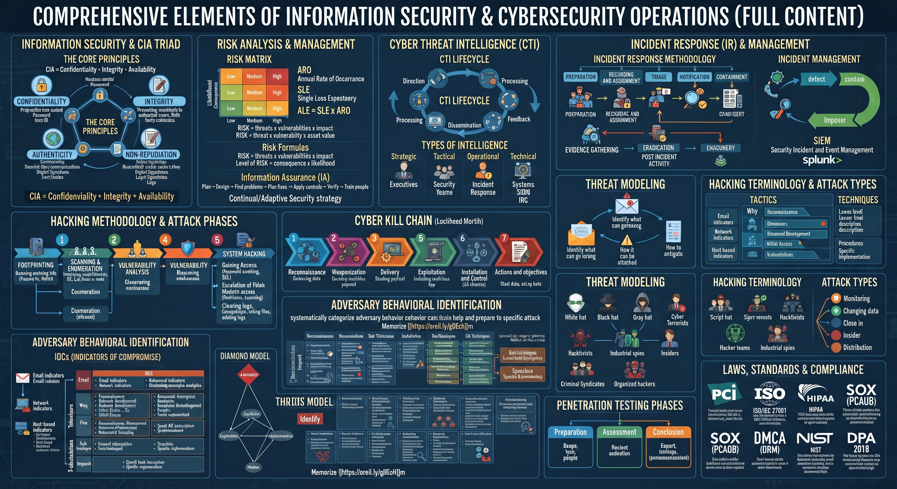

# 📚 Ders Materyalleri ve Konu Dizini

Bu bölüm, sınav müfredatındaki 20 temel konuyu adım adım ilerleyebilmeniz için hazırlanmıştır.

# 📚 CEH v13 Ders Materyalleri ve Konu Dizini

1. **[Modül 01: Etik Hackerlığa Giriş](./Moduller/01-etik-hackerliga-giris/)**
   1. [Bilgi Güvenliğine Genel Bakış](./Moduller/01-etik-hackerliga-giris/bilgi-guvenligine-genel-bakis.md.txt)
   2. [Güvenlik Tehditleri ve Saldırılar](./Moduller/01-etik-hackerliga-giris/guvenlik-tehditleri-ve-saldirilar.md.txt)
   3. [Bilgi Güvenliği Kontrolleri](./Moduller/01-etik-hackerliga-giris/bilgi-guvenligi-kontrolleri.md.txt)
      1. [Risk Yönetimi](./Moduller/01-etik-hackerliga-giris/risk-yonetimi.md.txt)
      2. [Olay Yönetimi](./Moduller/01-etik-hackerliga-giris/olay-yonetimi.md.txt)
      3. [Ağ Güvenliği](./Moduller/01-etik-hackerliga-giris/ag-guvenligi.md.txt)
      4. [Güvenlik Politikaları](./Moduller/01-etik-hackerliga-giris/guvenlik-politikalari.md.txt)
      5. [Fiziksel Güvenlik](./Moduller/01-etik-hackerliga-giris/fiziksel-guvenlik.md.txt)
      6. [Veri Sızıntısı, Yedekleme ve Kurtarma](./Moduller/01-etik-hackerliga-giris/veri-sizintisi-yedekleme-ve-kurtarma.md.txt)
      7. [Kimlik ve Erişim Yönetimi (IAM)](./Moduller/01-etik-hackerliga-giris/kimlik-ve-erisim-yonetimi-iam.md.txt)
   4. [Tehdit İstihbaratı ve Adli Bilişim](./Moduller/01-etik-hackerliga-giris/tehdit-istihbarati-ve-adli-bilisim.md.txt)
   5. [Yasalar, Standartlar ve Düzenlemeler](./Moduller/01-etik-hackerliga-giris/yasalar-standartlar-ve-duzenlemeler.md.txt)
   6. [Hacker Türleri](./Moduller/01-etik-hackerliga-giris/hacker-turleri.md.txt)
   7. [Hackleme Aşamaları](./Moduller/01-etik-hackerliga-giris/hackleme-asamalari.md.txt)
   8. [Sızma Testi](./Moduller/01-etik-hackerliga-giris/sizma-testi.md.txt)
   9. [Sızma Testi Aşamaları](./Moduller/01-etik-hackerliga-giris/sizma-testi-asamalari.md.txt)

2. **[Modül 02: Ayak İzi ve Keşif](./Moduller/02-ayak-izi-ve-kesif/)**
   1. [Ayak İzine Genel Bakış](./Moduller/02-ayak-izi-ve-kesif/ayak-izine-genel-bakis.md.txt)
   2. [Arama Motorları ve Çevrimiçi Kaynaklar](./Moduller/02-ayak-izi-ve-kesif/arama-motorlari-ve-cevrimici-kaynaklar.md.txt)
   3. [WHOIS, Coğrafi Konum ve DNS Sorgulama](./Moduller/02-ayak-izi-ve-kesif/whois-cografi-konum-ve-dns-sorgulama.md.txt)
   4. [E-posta Ayak İzi](./Moduller/02-ayak-izi-ve-kesif/eposta-ayak-izi.md.txt)
   5. [Web Sitesi Ayak İzi](./Moduller/02-ayak-izi-ve-kesif/web-sitesi-ayak-izi.md.txt)
   6. [Ağ Ayak İzi](./Moduller/02-ayak-izi-ve-kesif/ag-ayak-izi.md.txt)

3. **[Modül 03: Ağ Tarama](./Moduller/03-ag-tarama/)**
   1. [Ağ Taramaya Genel Bakış](./Moduller/03-ag-tarama/ag-taramaya-genel-bakis.md.txt)
   2. [TCP/IP Temelleri](./Moduller/03-ag-tarama/tcp-ip-temelleri.md.txt)
   3. [Tarama Araçları](./Moduller/03-ag-tarama/tarama-araclari.md.txt)
   4. [Tarama Teknikleri](./Moduller/03-ag-tarama/tarama-teknikleri.md.txt)
   5. [IDS ve Güvenlik Duvarı Atlatma](./Moduller/03-ag-tarama/ids-ve-guvenlik-duvari-atlatma.md.txt)
   6. [Banner Yakalama](./Moduller/03-ag-tarama/banner-yakalama.md.txt)

4. **[Modül 04: Numaralandırma](./Moduller/04-numaralandirma/)**
   1. [Numaralandırmaya Genel Bakış](./Moduller/04-numaralandirma/numaralandirmaya-genel-bakis.md.txt)
   2. [DNS Numaralandırma](./Moduller/04-numaralandirma/dns-numaralandirma.md.txt)

5. **[Modül 05: Zafiyet Analizi](./Moduller/05-zafiyet-analizi/)**
   1. [Zafiyet Analizi](./Moduller/05-zafiyet-analizi/zafiyet-analizi.md.txt)
   2. [Yaygın Zafiyetler](./Moduller/05-zafiyet-analizi/yaygin-zafiyetler.md.txt)
   3. [Otomatik Sızma Testi Araçları](./Moduller/05-zafiyet-analizi/otomatik-sizma-testi-araclari.md.txt)

6. **[Modül 06: Sistem Hackleme](./Moduller/06-sistem-hackleme/)**
   1. [Parola Kırmaya Genel Bakış](./Moduller/06-sistem-hackleme/parola-kirmaya-genel-bakis.md.txt)
   2. [Microsoft Kimlik Doğrulama](./Moduller/06-sistem-hackleme/microsoft-kimlik-dogrulama.md.txt)
   3. [Parola Kırma Araçları](./Moduller/06-sistem-hackleme/parola-kirma-araclari.md.txt)
   4. [Linux Temelleri](./Moduller/06-sistem-hackleme/linux-temelleri.md.txt)
   5. [Yetki Yükseltme](./Moduller/06-sistem-hackleme/yetki-yukseltme.md.txt)
   6. [Uygulama Çalıştırma](./Moduller/06-sistem-hackleme/uygulama-calistirma.md.txt)
   7. [Dosya Gizleme](./Moduller/06-sistem-hackleme/dosya-gizleme.md.txt)
   8. [İzleri Gizleme](./Moduller/06-sistem-hackleme/izleri-gizleme.md.txt)

7. **[Modül 07: Zararlı Yazılım Tehditleri](./Moduller/07-zararli-yazilimlar/)**
   1. [Zararlı Yazılımlara Genel Bakış](./Moduller/07-zararli-yazilimlar/zararli-yazilimlara-genel-bakis.md.txt)
   2. [Truva Atları](./Moduller/07-zararli-yazilimlar/truva-atlari.md.txt)
   3. [Virüsler](./Moduller/07-zararli-yazilimlar/virusler.md.txt)
   4. [Zararlı Yazılım Analizi](./Moduller/07-zararli-yazilimlar/zararli-yazilim-analizi.md.txt)

8. **[Modül 08: Ağ Dinleme](./Moduller/08-ag-dinleme/)**
   1. [Ağ Dinlemeye Genel Bakış](./Moduller/08-ag-dinleme/ag-dinlemeye-genel-bakis.md.txt)
   2. [Ağ Dinleme Araçları](./Moduller/08-ag-dinleme/ag-dinleme-araclari.md.txt)
   3. [Ağ Dinleme Saldırılarına Genel Bakış](./Moduller/08-ag-dinleme/ag-dinleme-saldirilarina-genel-bakis.md.txt)
   4. [Aldatma Saldırıları](./Moduller/08-ag-dinleme/aldatma-saldirilari.md.txt)
   5. [ARP Zehirlenmesi](./Moduller/08-ag-dinleme/arp-zehirlenmesi.md.txt)

9. **[Modül 09: Sosyal Mühendislik](./Moduller/09-sosyal-muhendislik/)**
   1. [Sosyal Mühendisliğe Genel Bakış](./Moduller/09-sosyal-muhendislik/sosyal-muhendislige-genel-bakis.md.txt)
   2. [Sosyal Mühendislik Türleri](./Moduller/09-sosyal-muhendislik/sosyal-muhendislik-turleri.md.txt)

10. **[Modül 10: Hizmet Engelleme Saldırıları](./Moduller/10-dos-ddos/)**
    1. [Hizmet Engelleme Saldırıları (Hazırlanıyor)](./Moduller/10-dos-ddos/sonra.txt)

11. **[Modül 11: Oturum Ele Geçirme](./Moduller/11-oturum-ele-gecirme/)**
    1. [Oturum Ele Geçirme](./Moduller/11-oturum-ele-gecirme/oturum-ele-gecirme.md.txt)

12. **[Modül 12: IDS, Güvenlik Duvarı ve Bal Küpü Atlatma](./Moduller/12-ids-firewall-atlatma/)**
    1. [Saldırı Tespit Sistemleri (IDS)](./Moduller/12-ids-firewall-atlatma/saldiri-tespit-sistemleri-ids.md.txt)
    2. [IDS Atlatma](./Moduller/12-ids-firewall-atlatma/ids-atlatma.md.txt)
    3. [Güvenlik Duvarına Genel Bakış](./Moduller/12-ids-firewall-atlatma/guvenlik-duvarina-genel-bakis.md.txt)
    4. [Güvenlik Duvarı Atlatma](./Moduller/12-ids-firewall-atlatma/guvenlik-duvari-atlatma.md.txt)
    5. [Bal Küpü (Honeypot)](./Moduller/12-ids-firewall-atlatma/bal-kupu.md.txt)

13. **[Modül 13: Web Sunucularını Hackleme](./Moduller/13-web-sunuculari/)**
    1. [Web Sunucularını Hackleme](./Moduller/13-web-sunuculari/web-sunucularini-hackleme.md.txt)
    2. [Web Sunucusu Tehditleri ve Saldırılar](./Moduller/13-web-sunuculari/web-sunucusu-tehditleri-ve-saldirilar.md.txt)

14. **[Modül 14: Web Uygulamalarını Hackleme](./Moduller/14-web-uygulamalari/)**
    1. [Web Uygulamalarını Hackleme](./Moduller/14-web-uygulamalari/web-uygulamalarini-hackleme.md.txt)
    2. [OWASP Top 10 Tehditleri](./Moduller/14-web-uygulamalari/owasp-top-10-tehditleri.md.txt)
    3. [Hizmet Engelleme Saldırıları](./Moduller/14-web-uygulamalari/hizmet-engelleme-saldirilari.md.txt)
    4. [Oturum Ele Geçirme](./Moduller/14-web-uygulamalari/oturum-ele-gecirme.md.txt)

15. **[Modül 15: SQL Enjeksiyonu](./Moduller/15-sql-enjeksiyonu/)**
    1. [SQL Enjeksiyonuna Genel Bakış](./Moduller/15-sql-enjeksiyonu/sql-enjeksiyonuna-genel-bakis.md.txt)
    2. [SQL Enjeksiyonu Türleri](./Moduller/15-sql-enjeksiyonu/sql-enjeksiyonu-turleri.md.txt)

16. **[Modül 16: Kablosuz Ağları Hackleme](./Moduller/16-kablosuz-aglar/)**
    1. [Kablosuz Ağlara Genel Bakış](./Moduller/16-kablosuz-aglar/kablosuz-aglara-genel-bakis.md.txt)
    2. [AAA Protokolleri](./Moduller/16-kablosuz-aglar/aaa-protokolleri.md.txt)
    3. [Kablosuz Ağ Tehditleri ve Saldırılar](./Moduller/16-kablosuz-aglar/kablosuz-ag-tehditleri-ve-saldirilar.md.txt)
    4. [Kablosuz Ağ Güvenlik Araçları](./Moduller/16-kablosuz-aglar/kablosuz-ag-guvenlik-araclari.md.txt)
    5. [Bluetooth Güvenliği](./Moduller/16-kablosuz-aglar/bluetooth.md.txt)

17. **[Modül 17: Mobil Platformları Hackleme](./Moduller/17-mobil-platformlar/)**
    1. [Mobil Hackleme](./Moduller/17-mobil-platformlar/mobil-hackleme.md.txt)
    2. [Mobil Saldırı Vektörleri](./Moduller/17-mobil-platformlar/mobil-saldiri-vektorleri.md.txt)
    3. [Mobil Saldırılar](./Moduller/17-mobil-platformlar/mobil-saldirilar.md.txt)

18. **[Modül 18: IoT ve OT Hackleme](./Moduller/18-iot-ve-ot/)**
    1. [IoT Genel Bakış](./Moduller/18-iot-ve-ot/iot-genel-bakis.md.txt)
    2. [IoT Güvenliği](./Moduller/18-iot-ve-ot/iot-guvenligi.md.txt)

19. **[Modül 19: Bulut Bilişim](./Moduller/19-bulut-bilisim/)**
    1. [Bulut Bilişim](./Moduller/19-bulut-bilisim/bulut-bilisim.md.txt)
    2. [Bulut Güvenliği](./Moduller/19-bulut-bilisim/bulut-guvenligi.md.txt)
    3. [Konteyner Güvenliği](./Moduller/19-bulut-bilisim/konteyner-guvenligi.md.txt)

20. **[Modül 20: Kriptografi](./Moduller/20-kriptografi/)**
    1. [Kriptografiye Genel Bakış](./Moduller/20-kriptografi/kriptografiye-genel-bakis.md.txt)
    2. [Şifreleme Algoritmaları](./Moduller/20-kriptografi/sifreleme-algoritmalari.md.txt)
    3. [Özetleme Algoritmaları](./Moduller/20-kriptografi/ozetleme-algoritmalari.md.txt)
    4. [İletişim Şifreleme](./Moduller/20-kriptografi/iletisim-sifreleme.md.txt)
    5. [Tünelleme Protokolleri](./Moduller/20-kriptografi/tunelleme-protokolleri.md.txt)
    6. [Disk Şifreleme](./Moduller/20-kriptografi/disk-sifreleme.md.txt)
    7. [Kriptanaliz](./Moduller/20-kriptografi/kriptanaliz.md.txt)

---
⬅️ [Ana Menüye Dön](../README.md)

---
## 📄 Lisans ve Kaynakça

Bu ders materyalleri, [undergroundwires/CEH-in-bullet-points](https://github.com) deposundaki açık kaynaklı çalışma notlarından esinlenilerek ve **CC-BY-4.0** lisansı kapsamında Türkçeye uyarlanıp yeni görseller ve kaynaklarla zenginleştirilerek hazırlanmıştır.
